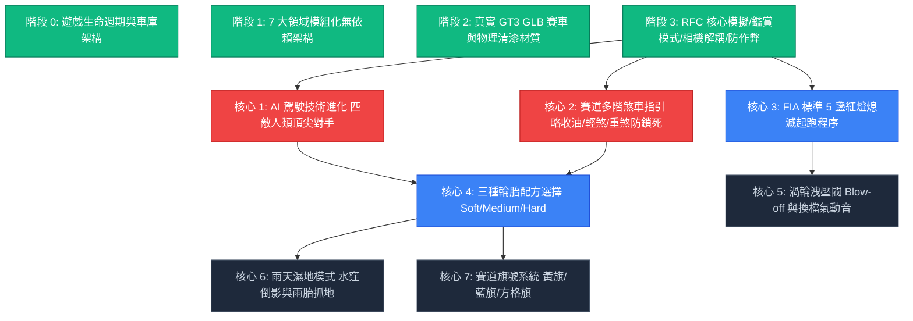
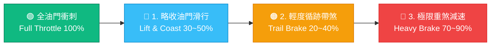

# 🏁 APEX PRO RACING // 全面系統優化方案計畫書 (v3.1 玩法核心強化版)

> **專案現況**：v2.2 核心物理重構、真 3D GLB GT3 賽車模型、360° 車輛鑑賞模式、無抖動相機解耦、自然倒車與終點線全檢查點驗證已全數穩定上線 (`5a6807a` / `f47cb84`)。  
> **改版方針**：去除枝微末節的外觀與震動小功能（已移除碟盤發光、熱衰竭與手機震動），全面聚焦於**硬核玩法完善度、競賽 AI 駕駛技術升級、以及賽道漸進式煞車/收油指引**，打造真正具備專業電競對戰感的 Web3D 賽車模擬器。

---

## 📊 一、當前計畫進度與全新核心里程碑全景 (Progress Overview)

---

## ✅ 二、已落地完成項目盤點 (What is Completed)

| 核心領域 | 里程碑 Commit | 已完成之關鍵功能與架構 |
| :--- | :--- | :--- |
| **全遊戲生命週期** | `f0431e6` | • 開場視覺封面 (`#scr-splash`) 與 Web Audio 手勢解鎖。 • 雙向設備偵測 (PC 鍵盤完整 MoTeC 儀表 vs 手機極簡觸控/陀螺儀)。 • 四步驟賽事精靈 (`#scr-setup`)、防凍結看門狗加載頁 (`#scr-loading`)、醒目暫停選單 (`#scr-pause`)。 • 三頁連貫式完賽結算畫面 (`#scr-results`) 與 S1/S2/S3 分段計時。 |
| **7 大領域模組化架構** | `d9b9e15` | • 將 8,000+ 行單體拆分為 `audio.js`、`circuits.js`、`render.js`、`physics.js`、`input.js`、`flow.js`、`main.js`。 • 零構建打包工具、全原生 Web API 驅動、雙擊或 GitHub Pages 瞬開。 |
| **真 3D 賽車模型與物理清漆** | `14bbfba` | • 全 4 款真實高面數賽車：Ferrari 458 GT3、Porsche 911 GT3 R (992)、Mercedes-AMG GT3 EVO、BMW M4 GT3。 • Three.js 官方 `MeshPhysicalMaterial` 清漆烤漆（`clearcoat: 1.0`）、棚拍 PMREM 柔光反射。 • 5 節點車輪/轉向/旋轉獨立骨架綁定，煞車卡鉗不隨輪旋轉、碟盤隨輪自轉。 • 自研 Three.js r128 `EXT_texture_webp` 外掛修復，支援 4K 原廠 WebP 賽道塗裝。 |
| **RFC 核心模擬與相機解耦** | `a8749e0` | • **360° 車輛鑑賞模式 (Inspect Mode)**：點擊車身平滑聚焦質心，水平 360° 無死鎖環視，垂直俯仰角夾緊於 $15^\circ \sim 85^\circ$（徹底解決萬向節倒置問題），縮放距離 $3.5\text{m} \sim 8.0\text{m}$，深色影棚光照環境隔絕。 • **相機解耦與路面反饋**：徹底消除注入相機的隨機噪聲向量；以 $y = A e^{-\gamma t} \cos(\omega t)$ 底盤局部阻尼諧振驅動車體網格跳動；35~50 Hz 低頻路緣石音效 + HTML5 Gamepad API 實體手把雙馬達震動。 • **檢查點防作弊與自然倒車**：移除起跑線倒車鎖定與干擾橫幅，倒車手感自然真實；終點線檢查點全覆蓋驗證（必須正向通過所有中間檢查點才計入圈速與進入完賽畫面）。 |

---

## 🎯 三、核心玩法重磅優化方案 (Core Gameplay Improvements)

---

### 🏎️ 方案 1：AI 駕駛技術全面進化（匹敵人類頂尖對手）

#### 1. 痛點診斷（現行 AI 為何過慢？）
1. **失誤懲罰過度嚴苛**：現行邏輯中，當玩家貼近 AI（間距 < 42m）時，AI 壓力值瞬間飆破 78，觸發持續 2.6 秒、速度暴跌 28%（`targetV *= 0.72`）的崩潰失誤，導致玩家隨便就能輕鬆刷過。
2. **入彎速度極限過於保守**：現行 AI 的彎道極限速度是根據 $1.42\text{G}$ 計算，低於玩家實際抓地力上限（$1.65\text{G}$），進彎前減速過多。
3. **直道加速缺乏檔位爆發力**：AI 僅使用簡化的平滑功率公式 `338.0 / vEff`，缺乏低檔位大扭力衝刺，起跑與出彎加速全面劣於人類玩家。
4. **難度級距縮水**：外星人（Alien）難度係數僅為 `1.05`，頂尖玩家毫無壓迫感。

#### 2. 全新工程優化方案
* **真實動態配速與極限過彎模型 (Dynamic Pro Apex Solver)**：
  * 將 AI 的彎道極限側向 G 值提升至 $1.55\text{G} \sim 1.62\text{G}$，AI 能緊緊咬住內側紅白路緣石（Apex Kerb），以極高車速切入彎心。
  * **外星人 Alien 難度係數提升至 `1.08 ~ 1.12`**：在頂級難度下，AI 單圈配速將達到甚至超越官方 PRO 幽靈車的基準圈速，迫使玩家必須跑出近乎零失誤的最佳線才能勝出。
* **晚煞車超車與出彎早給油 (Late Braking & Early Throttle Exit)**：
  * **進攻走線**：當 AI 位於後方逼近玩家時，不再只跟在屁股後方，而是主動於入彎前 50m 向內線切出半個車身，延後煞車點 10~15m（Late Apex Dive），進行積極切入進攻。
  * **出彎彈射**：AI 根據彎道曲率漸出階段（Exit Phase），提早 0.3 秒全油門開油，利用全賽道寬度進行外側拋出加速。
* **重新校準直道加速與動態檔位扭力**：
  * 賦予 AI 具備 GT3 序列式變速箱的低檔位加速模型，起跑 0-100 km/h 縮減至 3.2~3.4 秒，直道尾速可逼近 290~298 km/h。
* **真實抗壓與微失誤機制 (Micro-Mistake Mechanic)**：
  * 廢除「直接減速 28% 讓車」的自毀代碼。
  * 改為真實賽車手的**微幅失誤**：高壓下若入彎速度過高，僅產生輕微推頭外拋（走線外推 1.0~1.8m，速度微損 4%~7%），玩家必須把握僅有的 0.5 秒空檔果斷插內線超車，大幅提升對戰張力！

---

### 🛑 方案 2：賽道多階煞車與油門指引（杜絕長時間重煞鎖死）

#### 1. 痛點診斷（現行煞車提示問題何在？）
* 目前系統只有一個單一粗暴的警告標籤：`🛑 BRAKE NOW！前方急彎超速 — 請立即踩煞車減速`。
* 觸發條件極為遲鈍（需超速 28 km/h 且煞車小於 0.2 才觸發），一旦跳出，新手與老手往往下意識將煞車踏板「一腳踩死（100% Brake Input）」。
* **致命惡果**：長時間 100% 重煞直接觸發前輪鎖死（`isBrakeLockup`），前輪完全喪失導向抓地力，車頭直直推頭撞牆；同時車速被削得過低，出彎宛如龜速。
* **缺乏專業賽車技術分級**：賽道上許多彎道其實**根本不需要重煞**，只需「收油滑行（Lift & Coast）」或「輕含煞車循跡（Trail Braking 20%~40%）」。

#### 2. 全新工程優化方案
構建 **三階漸進式駕駛指引系統（Three-Tier Progressive Cue System）**：

1. **第一階：略收油門滑行提示 (Lift & Coast · 藍/青綠燈)**：
   * **適用彎道**：高速大曲率弧形彎（如蒙札 Curva Grande、富士 100R 複合彎中段）。
   * **提示訊號**：HUD 顯示輕量標籤 `⚡ LIFT OFF · 鬆開油門滑行入彎`。
   * **原理**：不踩煞車，僅藉由引擎煞車與風阻平順減速，將部分車重溫和轉移至前輪，保持最充沛的車速滑過彎心。
2. **第二階：輕度循跡帶煞提示 (Light Trail Brake · 琥珀橘燈)**：
   * **適用彎道**：中速技術彎、連續 S 彎入口。
   * **提示訊號**：HUD 顯示 `🟡 TRAIL BRAKE · 輕含煞車 (30%) 咬住內線`。
   * **原理**：施加 20%~40% 柔和制動力，下壓車頭維持前輪循跡指向性，**嚴禁深踩**，徹底杜絕輪胎抱死鎖死。
3. **第三階：極限重煞提示 (Heavy Threshold Braking · 鮮紅燈)**：
   * **適用彎道**：大直線末端、一檔/二檔髮夾彎（如富士 T2、T10 髮夾彎、蒙札 T8 帕拉波利卡）。
   * **提示訊號**：HUD 顯示 `🛑 HEAVY BRAKE · 重煞至 80 km/h ➔ 出彎放開開油`。
   * **改良機制**：明確顯示「目標入彎速度」，提示音為清脆節奏蜂鳴；當車速降至目標窗口時，紅燈立即切換為綠燈指示「開油」，避免玩家踩著煞車不放而大幅丟失圈速。
4. **3D 地面動態賽車走線動態色彩升級 (Dynamic 3D Racing Ribbon)**：
   * 地面 3D 走線綵帶依據即時計算的建議操作連續漸變：
     * **純翠綠 (`#10b981`)**：全油門加速區。
     * **亮青藍 (`#38bdf8`)**：收油滑行區（Lift Zone）。
     * **琥珀金 (`#f59e0b`)**：輕煞循跡區（Trail Braking Zone）。
     * **亮赤紅 (`#ef4444`)**：重度極限煞車區（Threshold Braking Zone）。

---

### 🚦 方案 3：FIA 標準 5 盞紅燈熄滅起跑程序 (5-Red-Light Gantry Start)

* **設計機制**：
  * 起跑時所有賽車靜止於發車格（Grid Slot）。
  * 畫面頂部懸掛 FIA 規格 5 聯裝龍門起跑信號燈：
    * $t = 1.0\text{s}$：🔴
    * $t = 2.0\text{s}$：🔴🔴
    * $t = 3.0\text{s}$：🔴🔴🔴
    * $t = 4.0\text{s}$：🔴🔴🔴🔴
    * $t = 5.0\text{s}$：🔴🔴🔴🔴🔴（5 盞全亮，引擎轉速轟鳴拉至最佳起步點）
  * **隨機停頓滅燈起跑**：經過隨機亂數（$0.2 \sim 2.0\text{ 秒}$）不確定等待期，**5 盞紅燈同時熄滅**！
  * **搶跑判定 (Jump Start Detection)**：若玩家在紅燈熄滅前油門踩過深、車身移位超過 0.5m，立即判定搶跑，賽後成績加罰 5.0 秒，營造滿分的電競大獎賽起跑儀式感。

---

### 🛞 方案 4：三種專業輪胎配方選擇 (Soft / Medium / Hard)

* **Soft (軟胎 - 紅色標識)**：
  * 提供高達 $1.65\text{ G}$ 的極限機械抓地力，入彎指向極度精準敏銳。
  * 適合計時挑戰賽（Time Attack）全力衝刺刷破圈速紀錄。
* **Medium (中性胎 - 黃色標識)**：
  * $1.52\text{ G}$ 均衡抓地力，工作寬容度高，適合標準 2 圈 AI 錦標爭先賽。
* **Hard (硬胎 - 白色標識)**：
  * $1.42\text{ G}$ 耐磨型硬胎，滑移容忍度大，適合長距離耐力駕駛或練習路線。
* **UI 整合**：出賽設定精靈（Step 2 或 Step 4）提供一鍵輪胎配方切換卡片。

---

### 🔊 方案 5：高階聽覺回饋（渦輪洩壓與換檔氣動衝擊）

* **大油門收油洩壓音 (Turbo Blow-off Flutter / Whoosh)**：
  * 高轉速全油門突然收油（Lift-off）時，Web Audio 濾波合成器觸發清脆的氣流洩壓撲哧聲。
* **序列換檔金屬撞擊音 (Pneumatic Shift Clunk)**：
  * 升檔瞬間引擎點火切斷（Ignition Cut）0.08 秒，伴隨氣動撥片推入齒輪的沉重金屬機械音。

---

### 🌧️ 方案 6：賽事環境擴充（雨天濕地模式與旗號系統）

* **雨天濕地模式 (Wet Weather)**：賽道柏油路面鏡面水窪反射，後輪捲起水煙粒子，抓地力下降 28%。
* **賽道旗號系統 (Flag System)**：動態出示黃旗（AI 事故緩行）、藍旗（被套圈讓道）、方格旗（最後一圈衝線揮舞）。

---

## 📋 四、全新優化項目評級矩陣 (Priority Matrix v3.1)

| 方案名稱 | 核心類別 | 玩法價值 | 實作難度 | 推薦優先度 | 建議開發排程 |
| :--- | :---: | :---: | :---: | :---: | :---: |
| **1. AI 駕駛技術進化（速度/走線/晚煞車）** | 競賽對戰 | ★★★★★ | ★★☆☆☆ (中低) | 🥇 **第一優先 (核心)** | **Phase 1** |
| **2. 賽道多階煞車提示（略收油/輕煞/防抱死）** | 駕駛輔助 | ★★★★★ | ★★☆☆☆ (低) | 🥇 **第一優先 (核心)** | **Phase 1** |
| **3. FIA 5 盞紅燈起跑程序與搶跑懲罰** | 賽事儀式 | ★★★★★ | ★☆☆☆☆ (低) | 🥇 **第一優先 (氛圍)** | **Phase 1** |
| **4. 三種輪胎配方選擇 (Soft/Med/Hard)** | 物理策略 | ★★★★☆ | ★★☆☆☆ (中低) | 🥈 **第二優先** | **Phase 2** |
| **5. 渦輪洩壓閥與換檔機械衝擊音** | 聽覺反饋 | ★★★★☆ | ★☆☆☆☆ (極低) | 🥈 **第二優先** | **Phase 2** |
| **6. 賽道旗號系統 (黃旗/藍旗/方格旗)** | 賽事規則 | ★★★☆☆ | ★★☆☆☆ (中等) | 🥉 **第三優先** | **Phase 3** |
| **7. 雨天濕地模式與雨霧水煙粒子** | 氣候系統 | ★★★★★ | ★★★★☆ (高) | 🥉 **第三優先** | **Phase 3** |

---

## 🚀 五、下一步行動建議 (Recommended Next Steps)

依據您的指導，我們將完全跳過不實用的外觀細節，直接進入核心玩法的全面升級。

**建議首波推進組合（Phase 1 核心三部曲）：**
1. **優化 AI 速度與競技走線**：調升極限側向 G 值、重構 Alien 難度、引入出彎早給油與晚煞車進攻，取消毀滅性失誤懲罰，讓 AI 成為名副其實的頂尖對手。
2. **賽道多階煞車/油門導引**：新增「略收油滑行」與「輕度循跡帶煞」，重構 HUD 提示與 3D 地面動態綵帶顏色，杜絕長時間重踩煞車導致的前輪鎖死推頭。
3. **FIA 5 盞紅燈起跑程序**：導入 5 聯裝紅燈依序點亮與隨機滅燈起跑，起步儀式感全面拉滿。

請確認是否直接依照此組合展開 Phase 1 開發，或針對細節有進一步想法！
