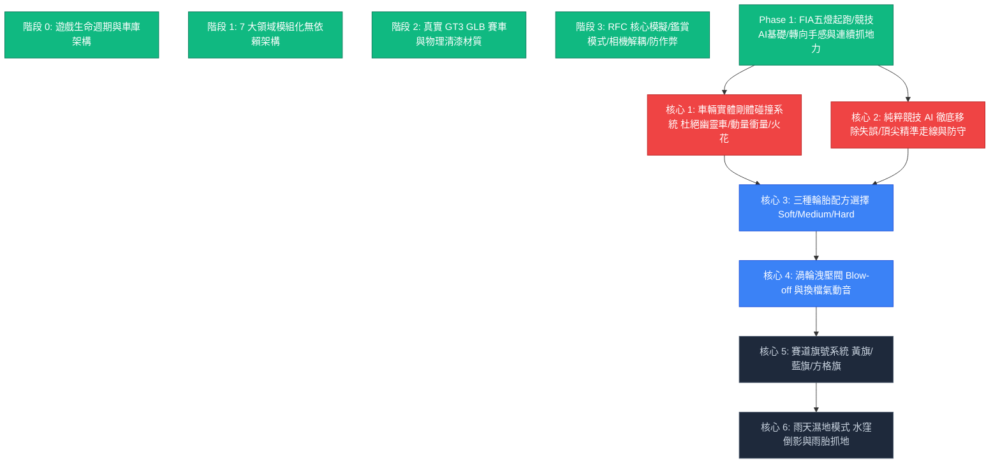
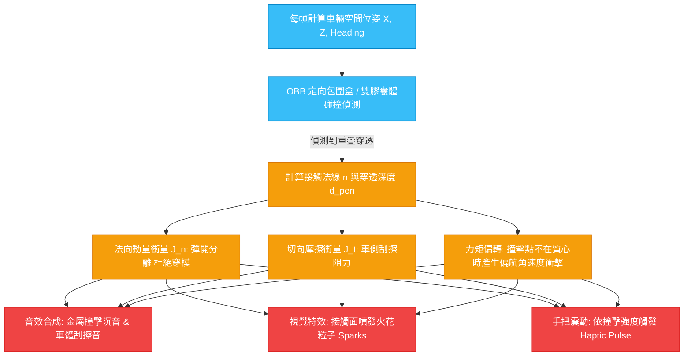

# 🏁 APEX PRO RACING // 全面系統優化方案計畫書 (v3.2 剛體實體碰撞與純粹競技 AI 版)

> **專案現況**：Phase 1 核心升級（FIA 5 盞紅燈起跑程序、競技級 AI 基礎、3D 走線四色引導）以及過彎轉向手感大重構（雙速阻尼回正、連續抓地力荷載轉移、消除過載斷崖、3D 標牌鏡像修正）已全數實作驗證並推送上線 (`fa6fa32` / `3a22b21`)。  
> **改版方針**：去除消耗玩家熱情的無謂機制（**全面取消 AI 失誤系統**，還原頂尖對決的純粹競速快感），並導入重磅硬核玩法——**車輛實體剛體碰撞系統（Rigid-Body Collisions）**，使賽車徹底擺脫「穿模幽靈車」，實現真實肉搏搶位（Trading Paint）、撞擊動量衝量與力矩偏轉！

---

## 📊 一、當前計畫進度與全新核心里程碑全景 (Progress Overview)

---

## ✅ 二、已落地完成項目盤點 (What is Completed)

| 核心領域 | 里程碑 Commit | 已完成之關鍵功能與架構 |
| :--- | :--- | :--- |
| **全遊戲生命週期** | `f0431e6` | • 開場視覺封面 (`#scr-splash`) 與 Web Audio 手勢解鎖。 • 雙向設備偵測 (PC 鍵盤完整 MoTeC 儀表 vs 手機極簡觸控/陀螺儀)。 • 四步驟賽事精靈 (`#scr-setup`)、防凍結看門狗加載頁 (`#scr-loading`)、醒目暫停選單 (`#scr-pause`)。 • 三頁連貫式完賽結算畫面 (`#scr-results`) 與 S1/S2/S3 分段計時。 |
| **7 大領域模組化架構** | `d9b9e15` | • 將 8,000+ 行單體拆分為 `audio.js`、`circuits.js`、`render.js`、`physics.js`、`input.js`、`flow.js`、`main.js`。 • 零構建打包工具、全原生 Web API 驅動、雙擊或 GitHub Pages 瞬開。 |
| **真 3D 賽車模型與物理清漆** | `14bbfba` | • 全 4 款真實高面數賽車：Ferrari 458 GT3、Porsche 911 GT3 R (992)、Mercedes-AMG GT3 EVO、BMW M4 GT3。 • Three.js 官方 `MeshPhysicalMaterial` 清漆烤漆（`clearcoat: 1.0`）、棚拍 PMREM 柔光反射。 • 5 節點車輪/轉向/旋轉獨立骨架綁定，煞車卡鉗不隨輪旋轉、碟盤隨輪自轉。 • 自研 Three.js r128 `EXT_texture_webp` 外掛修復，支援 4K 原廠 WebP 賽道塗裝。 |
| **RFC 核心模擬與相機解耦** | `a8749e0` | • **360° 車輛鑑賞模式 (Inspect Mode)**：點擊車身平滑聚焦質心，水平 360° 無死鎖環視，垂直俯仰角夾緊於 $15^\circ \sim 85^\circ$（徹底解決萬向節倒置問題）。 • **相機解耦與路面反饋**：徹底消除注入相機的隨機噪聲向量；以底盤局部阻尼諧振驅動車體網格跳動；35~50 Hz 低頻路緣石音效 + Gamepad 震動。 • **檢查點防作弊與自然倒車**：移除起跑線倒車鎖定與干擾橫幅，終點線 16 檢查點全覆蓋驗證。 |
| **Phase 1 競賽核心與起跑程序** | `fa6fa32` | • **FIA 5 盞紅燈起跑程序**：0.85s 逐顆點亮，0.25~2.00s 隨機駐留，同時滅燈發車；起步握持煞車可原地轟油，熄滅前偷跑車移 >0.5m 嚴格判罰 +5.0s 併入成績。 • **競技級 AI 基礎**：難度提升為 Clubman (0.92) / PRO (1.0) / Alien (1.10)，具備晚煞車進攻與直道真空帶彈弓超車。 • **漸進動態走線**：3D 路面動態綵帶升級為四色漸變（綠:全油 / 藍:略收油 / 橘:輕含煞 / 紅:重煞）。 |
| **過彎手感與轉向模型大重構** | `3a22b21` | • **雙速阻尼回正與反打提速**：自回正半衰期延長至 140~220ms，短點方向鍵不再斷崖彈直；反打提供 1.95x 敏捷響應。 • **消除三大階躍懸崖**：拔除 0.88 推頭斷崖，導入連續 Peak Slip 平台；改用連續荷載轉移取代 0.78 全油門硬開關；平滑 126 km/h 橫擺階躍。 • **視角與賽道體驗修復**：追尾視角導入平滑阻尼與微幅 ±1.5° 彎心預瞄；修復 3D 距離看板水平鏡像反字；移除過彎殘留的 HUD 重煞紅框彈窗。 |

---

## 🎯 三、核心玩法重磅優化方案 (Core Gameplay Improvements)

---

### 💥 方案 1：車輛實體剛體碰撞與衝量回饋系統 (Rigid-Body Vehicle-to-Vehicle Collisions)

#### 1. 痛點診斷（現行系統為何缺乏真實肉搏感？）
* 目前遊戲中，賽車之間主要依賴簡化的軌道橫向排斥邏輯（`targetD += 2.8`）；當玩家走線激進逼近 AI 時，容易出現**「車體相互穿模（Ghosting 幽靈車）」**，或者出現毫無動量反饋的生硬閃避。
* 真實賽車比賽中最刺激的精髓——**「貼身肉搏（Trading Paint）」、「入彎卡位擠壓」、「車側頂撞救車」與「追尾推擠」**完全缺失，大幅削弱了輪對輪（Wheel-to-Wheel）防守與進攻的緊張感。

#### 2. 全新剛體碰撞工程架構 (Physics Collision Pipeline)

1. **碰撞幾何形狀 (Oriented Bounding Box / Multi-Capsule)**：
   * 為玩家與每輛 AI 建立精準車身剛體外框：長度 $4.7\text{m}$、寬度 $2.0\text{m}$，隨實時航向角 $\psi$（`simState.heading`）旋轉。
   * 採用分離軸定理 (Separating Axis Theorem, SAT) 或雙圓膠囊體進行毫秒級快速干涉判定。
2. **法向動量衝量分離 ($J_n$)**：
   * 當兩車接觸時，立即計算兩車沿接觸法線的相對速度 $v_{rel} = (v_1 - v_2) \cdot n$。
   * 依動量守恆定律與 GT3 車架微彈性恢復係數（$e \approx 0.28$）施加法向反衝量：
     $$J_n = \frac{-(1 + e) v_{rel}}{\frac{1}{m_1} + \frac{1}{m_2}}$$
   * 瞬間修正兩車空間位置與速度向量，徹底消滅穿模，讓玩家能實質「推開」或「頂住」AI 車身。
3. **切向摩擦與肉搏阻力 ($J_t$)**：
   * 兩車側邊並排刮擦（Door Banging）時，施加庫侖摩擦衝量 $J_t = \mu_{scrape} \cdot J_n$，讓貼身肉搏產生真實的車速拖曳感。
4. **偏航力矩與甩尾偏轉 (Angular Torque Deflection)**：
   * 若撞擊點偏離車身質心（例如頂撞車尾外側進行美式 PIT 操作），將產生旋轉力矩衝擊 $\Delta \omega = \frac{r \times J}{I_{yaw}}$，對受撞車輛的 `yawRate` 造成瞬間偏轉，考驗車手反打救車實力！
5. **沉浸式反饋 (Audio & Visual FX)**：
   * **撞擊金屬音**：Web Audio 合成金屬撞擊沉悶聲（Thud）與車身外殼刮擦聲。
   * **飛濺火花粒子**：在接觸點瞬間迸發金屬火花粒子（Spark Particles）。
   * **手把強震**：觸發實體手把強震動脈衝。

---

### 🏎️ 方案 2：純粹競技 AI（徹底廢除失誤機制，還原硬核頂尖對手）

#### 1. 痛點診斷（為何必須徹底取消 AI 失誤？）
* 依用戶實際體驗反饋：現行代碼中的「AI 壓力值（`stress`）」與「被貼近時觸發微失誤 / 走線外拋（`ai.mistakeTimer` / `MISSED APEX`）」**只會無端消耗玩家的競技熱情**。
* 賽車遊戲最迷人的核心在於「以硬實力擊敗強敵」，若 AI 總是在被逼近時莫名其妙自亂陣腳、放慢讓車，玩家會覺得勝利是「系統放水施捨」，毫無成就感。

#### 2. 全新純粹競技 AI 工程方案
* **全面移除失誤機制代碼**：
  * 徹底刪除 `ai.stress`、`ai.mistakeTimer`、`ai.mistakeType` 與任何外拋減速邏輯。
  * AI 永不主動自爆、永不莫名減速，無論身後受到多大壓迫，始終精準、冷酷地維持極限圈速配速。
* **純粹靠賽車技術一較高下**：
  * AI 依靠真實的**入彎晚煞車、緊咬路緣石走線、出彎提早開油、直道尾流彈射、以及剛體碰撞卡位**與玩家對抗。
  * 玩家要超越 AI，必須真正做到延後煞車點、更優的出彎抓地管理、或利用剛體碰撞卡住內線超車，全面引爆電競級競速對抗的純粹樂趣！

---

### 🛞 方案 3：三種專業輪胎配方選擇 (Soft / Medium / Hard)

* **Soft (軟胎 - 紅色標識)**：
  * 提供高達 $1.65\text{ G}$ 的極限機械抓地力，入彎指向極度精準敏銳。
  * 適合計時挑戰賽（Time Attack）全力衝刺刷破圈速紀錄。
* **Medium (中性胎 - 黃色標識)**：
  * $1.52\text{ G}$ 均衡抓地力，工作寬容度高，適合標準 2 圈 AI 錦標爭先賽。
* **Hard (硬胎 - 白色標識)**：
  * $1.42\text{ G}$ 耐磨型硬胎，滑移容忍度大，適合長距離耐力駕駛或練習路線。
* **UI 整合**：出賽設定精靈（Step 2 或 Step 4）提供一鍵輪胎配方切換卡片，並反映於 HUD 與胎壁顏色。

---

### 🔊 方案 4：高階聽覺回饋（渦輪洩壓與換檔氣動衝擊）

* **大油門收油洩壓音 (Turbo Blow-off Flutter / Whoosh)**：
  * 高轉速全油門突然收油（Lift-off）時，Web Audio 濾波合成器觸發清脆的氣流洩壓撲哧聲。
* **序列換檔金屬撞擊音 (Pneumatic Shift Clunk)**：
  * 升檔瞬間引擎點火切斷（Ignition Cut）0.08 秒，伴隨氣動撥片推入齒輪的沉重金屬機械音。

---

### 🌧️ 方案 5：賽事環境與旗號系統

* **賽道旗號系統 (Flag System)**：動態出示黃旗（賽道事故緩行）、藍旗（被套圈讓道）、方格旗（最後一圈衝線揮舞）。
* **雨天濕地模式 (Wet Weather)**：賽道柏油路面鏡面水窪反射，後輪捲起水煙粒子，抓地力下降 28%。

---

## 📋 四、全新優化項目評級矩陣 (Priority Matrix v3.2)

| 方案名稱 | 核心類別 | 玩法價值 | 實作難度 | 推薦優先度 | 建議開發排程 |
| :--- | :---: | :---: | :---: | :---: | :---: |
| **1. 車輛實體剛體碰撞系統 (動量/衝量/火花)** | 物理肉搏 | ★★★★★ | ★★★☆☆ (中等) | 🥇 **第一優先 (重磅核心)** | **Phase 2** |
| **2. 純粹競技 AI（全面移除失誤/頂尖精準配速）** | 競賽對戰 | ★★★★★ | ★☆☆☆☆ (極低) | 🥇 **第一優先 (立即可行)** | **Phase 2** |
| **3. 三種輪胎配方選擇 (Soft/Med/Hard)** | 物理策略 | ★★★★☆ | ★★☆☆☆ (中低) | 🥈 **第二優先** | **Phase 2** |
| **4. 渦輪洩壓閥與換檔機械衝擊音** | 聽覺反饋 | ★★★★☆ | ★☆☆☆☆ (極低) | 🥈 **第二優先** | **Phase 2** |
| **5. 賽道旗號系統 (黃旗/藍旗/方格旗)** | 賽事規則 | ★★★☆☆ | ★★☆☆☆ (中等) | 🥉 **第三優先** | **Phase 3** |
| **6. 雨天濕地模式與雨霧水煙粒子** | 氣候系統 | ★★★★★ | ★★★★☆ (高) | 🥉 **第三優先** | **Phase 3** |

---

## 🚀 五、下一步行動建議 (Recommended Next Steps)

依據您的最高指導原則——**「取消 AI 失誤，聚焦純粹競速；車輛剛體化，實現真實肉搏碰撞」**，我們將這兩大項定為 **Phase 2 的首發核心任務**：

1. **立即移除 AI 失誤與壓力代碼**：刪除 `stress`、`mistakeTimer`、`targetV *= 0.94` 等削弱邏輯，讓 AI 無論在何種纏鬥下都跑出最乾淨無暇的防守與進攻配速。
2. **實作車輛實體剛體碰撞系統**：
   - 建立 OBB/膠囊體干涉計算。
   - 實作法向排斥與動量衝量守恆，使兩車碰撞時能夠實質頂撞、卡位推擠。
   - 引入偏心撞擊力矩偏轉與擦碰火花粒子效果。
3. **搭配三種輪胎配方與高階換檔/洩壓音效**，使 Phase 2 成為完整度極高的硬核競技版本！
