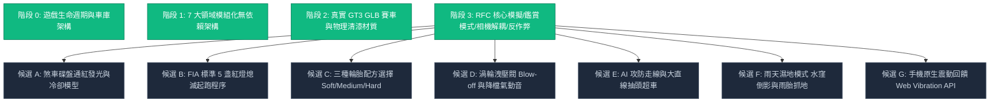

# 🏁 APEX PRO RACING // 全面系統優化方案計畫書 (v3.0 推進版)

> **專案現況**：v2.2 核心物理重構、真 3D GLB GT3 賽車模型、360° 車輛鑑賞模式、無抖動相機解耦、自然倒車與終點線全檢查點驗證已全數落地並穩定上線 (`5a6807a` / `f47cb84`)。  
> **文件目的**：找回先前規劃之完整優化藍圖，彙整目前「已完工項目」與「尚未實作之候選項目」，供後續改裝與排程決策。

---

## 📊 一、當前計畫進度與里程碑全景 (Progress Overview)

---

## ✅ 二、已落地完成項目盤點 (What is Completed)

| 核心領域 | 里程碑 Commit | 已完成之關鍵功能與架構 |
| :--- | :--- | :--- |
| **全遊戲生命週期** | `f0431e6` | • 開場視覺封面 (`#scr-splash`) 與 Web Audio 手勢解鎖。 • 雙向設備偵測 (PC 鍵盤完整 MoTeC 儀表 vs 手機極簡觸控/陀螺儀)。 • 四步驟賽事精靈 (`#scr-setup`)、防凍結看門狗加載頁 (`#scr-loading`)、醒目暫停選單 (`#scr-pause`)。 • 三頁連貫式完賽結算畫面 (`#scr-results`) 與 S1/S2/S3 分段計時。 |
| **7 大領域模組化架構** | `d9b9e15` | • 將 8,000+ 行單體拆分為 `audio.js`、`circuits.js`、`render.js`、`physics.js`、`input.js`、`flow.js`、`main.js`。 • 零構建打包工具、全原生 Web API 驅動、雙擊或 GitHub Pages 瞬開。 |
| **真 3D 賽車模型與物理清漆** | `14bbfba` | • 全 4 款真實高面數賽車：Ferrari 458 GT3、Porsche 911 GT3 R (992)、Mercedes-AMG GT3 EVO、BMW M4 GT3。 • Three.js 官方 `MeshPhysicalMaterial` 清漆烤漆（`clearcoat: 1.0`）、棚拍 PMREM 柔光反射。 • 5 節點車輪/轉向/旋轉獨立骨架綁定，煞車卡鉗不隨輪旋轉、碟盤隨輪自轉。 • 自研 Three.js r128 `EXT_texture_webp` 外掛修復，支援 4K 原廠 WebP 賽道塗裝。 |
| **RFC 核心模擬與相機解耦** | `a8749e0` | • **360° 車輛鑑賞模式 (Inspect Mode)**：點擊車身平滑聚焦質心，水平 360° 無死鎖環視，垂直俯仰角夾緊於 $15^\circ \sim 85^\circ$（徹底解決萬向節倒置問題），縮放距離 $3.5\text{m} \sim 8.0\text{m}$，深色影棚光照環境隔絕。 • **相機解耦與路面反饋**：徹底消除注入相機的隨機噪聲向量；以 $y = A e^{-\gamma t} \cos(\omega t)$ 底盤局部阻尼諧振驅動車體網格跳動；35~50 Hz 低頻路緣石音效 + HTML5 Gamepad API 實體手把雙馬達震動。 • **檢查點防作弊與自然倒車**：移除起跑線倒車鎖定與干擾橫幅，倒車手感自然真實；終點線檢查點全覆蓋驗證（必須正向通過所有中間檢查點才計入圈速與進入完賽畫面）。 |

---

## 🎯 三、先前計畫書提出之未實作候選項目 (Feature Candidates)

以下為先前規劃報告中提出、目前尚未排程實作之 4 大領域詳細規格，供您檢視與選擇想要優先推進的方向：

---

### 🎨 類別 A：極致視覺與微觀細節 (Visuals & Immersion)

#### 1. 煞車碟盤通紅發光與動態冷卻模型 (Brake Disc Thermal Glow)
* **設計機制**：
  * 高速（> 150 km/h）重踩煞車時，輪框內部的碳陶瓷/鑄鐵煞車碟盤（`DISC_*`）材質之 `emissive` 依據制動發熱公式，從冷態暗灰漸變為櫻桃暗紅（650°C），極限重煞飆升至亮橘紅至白熱光（1000°C）。
  * 放開煞車後，隨車速迎風對流散熱公式（Convective Cooling）指數衰減降溫冷卻。
* **效果**：在夜賽或入彎重煞時，輪圈內部透出高張力通紅火光，視覺極具 3A 大作衝擊力。

#### 2. 雨天濕地模式與賽道動態積水 (Wet Weather & Surface Reflections)
* **設計機制**：
  * 天氣選單增加「🌧️ 雨天濕地 (Wet Track)」。
  * 柏油路面 roughness 大幅調低、金屬度微升，產生如鏡面般的即時倒影水窪。
  * 車尾雙後輪在高速行駛時向後上方拉出「雨霧水煙粒子 (Water Spray Spray Particles)」。
  * 物理抓地力全面下降 25%~35%，過彎煞車距離拉長，重煞容易水漂滑移。

---

### 🏎️ 類別 B：專業車輛動力學與輪胎策略 (Physics & Tire Dynamics)

#### 1. 三種輪胎配方策略選擇 (Soft / Medium / Hard Compounds)
* **設計機制**：
  * **Soft (軟胎)**：提供 $1.56\text{ G}$ 超高機械抓地力，入彎指向極度凌厲，但連續衝刺 2 圈後產生熱衰退（抓地力每圈下降 8%），適合計時賽（Time Attack）刷最快圈速。
  * **Medium (中性胎)**：$1.45\text{ G}$ 均衡標準胎，耐磨與抓地力均衡，適合標準正賽。
  * **Hard (硬胎)**：$1.35\text{ G}$ 耐磨型硬胎，抓地力稍低但全程表現穩定抗熱衰，適合長距離耐力賽。
* **UI 整合**：出賽設定精靈（Step 4）新增輪胎配方切換卡片。

#### 2. 煞車熱衰竭機制 (Brake Fade)
* **設計機制**：
  * 當煞車碟盤溫度連續過熱超過 850°C 時，煞車制動摩擦係數暫態下降 18%~25%。
  * 玩家若連續重煞不控溫，踏板將出現「煞不住」的推頭推出現象，考驗精準煞車點控制與 Trail Braking 技巧。

#### 3. 四輪胎溫/磨耗即時熱力 HUD (Thermal Tire Monitor)
* **設計機制**：
  * 在 PC 模式右上角或 MoTeC 儀表板，顯示四輪（FL / FR / RL / RR）即時溫度與磨耗狀態方塊。
  * 藍（冷胎 < 70°C）➔ 綠（最佳工作溫度 85°C~105°C）➔ 橘紅（過熱 > 115°C）。

---

### 🏁 類別 C：賽事玩法與競技 AI (Gameplay & Racing AI)

#### 1. FIA / F1 標準 5 盞紅燈熄滅起跑程序 (5-Red-Light Gantry Start)
* **設計機制**：
  * 正賽開始時，車輛靜止停於發車格。
  * 畫面頂部懸掛 5 盞紅色龍門信號燈（Gantry Lights），依序每 1 秒亮起 1 盞（🔴 ➔ 🔴🔴 ➔ 🔴🔴🔴 ➔ 🔴🔴🔴🔴 ➔ 🔴🔴🔴🔴🔴）。
  * 5 盞全亮後，進入隨機亂數（$0.2 \sim 2.2\text{ 秒}$）停頓，隨後 **5 盞紅燈同時熄滅**！
  * 燈滅瞬間踩下油門正式起跑；若在紅燈熄滅前偷跑（Jump Start），自動處以罰秒（+5.0s）或維修區通道處罰（Drive-Through Penalty）。

#### 2. AI 賽車攻防路徑與大直線抽頭超車 (Defensive AI & Slipstream Overtake)
* **設計機制**：
  * **防守走線**：當玩家企圖在入彎前切入內線進攻時，前車 AI 會根據後視鏡距離向內線卡位（Defensive Line），迫使玩家走外線晚煞車超車。
  * **大直線抽頭**：AI 跟隨在玩家車尾進入真空尾流區（Slipstream）獲得速度增益，並在到達超車窗口時向外抽頭超車。

#### 3. 賽道旗號系統 (Racing Flags System)
* **設計機制**：
  * **黃旗 (Yellow Flag)**：前方 AI 發生碰撞或打滑時，賽段出示黃旗，禁止超車且需減速。
  * **藍旗 (Blue Flag)**：慢車被套圈時，指示靠外側讓過領先車輛。
  * **黑白方格旗 (Chequered Flag)**：最後一圈衝線時終點線上空動態揮舞方格旗。

---

### 🔊 類別 D：高階音效與周邊觸覺 (Audio & Haptics)

#### 1. 渦輪進氣洩壓閥音效 (Turbo Blow-Off Valve) 與換檔氣動衝擊音
* **設計機制**：
  * 大油門加速後突然收油（Lift-Off）時，Web Audio 合成器產生渦輪高壓進氣洩壓的清脆「啾～嘶～（flutter/whoosh）」氣流聲。
  * 序列式變速箱換檔瞬間，增加氣動換檔執行機構的「喀噠（Pneumatic Shift Clunk）」金屬打齒撞擊聲。

#### 2. 手機端原生震動回饋 (Web Vibration API for Mobile)
* **設計機制**：
  * 利用手機瀏覽器原生 `navigator.vibrate`：
    * 輪胎重煞鎖死：觸發 50ms 高頻短動脈衝，模擬真實 ABS 彈腳震顫。
    * 壓上路緣石：觸發與車速頻率同步之節奏性鋸齒波震動。
    * 擦撞牆面護欄：觸發單次強烈重擊震動（180ms）。

---

## 📋 四、優化項目評級與推薦矩陣 (Priority Matrix)

| 方案名稱 | 視覺/遊戲性價值 | 開發與驗證複雜度 | 推薦優先度 | 建議開發階段 |
| :--- | :---: | :---: | :---: | :---: |
| **A1. 煞車碟盤通紅發光與散熱模型** | ★★★★★ | ★★☆☆☆ (低) | 🥇 **極高 (最立竿見影)** | **Phase 1** |
| **C1. 5 盞紅燈熄滅起跑與搶跑判定** | ★★★★★ | ★★☆☆☆ (低) | 🥇 **極高 (儀式感倍增)** | **Phase 1** |
| **D1. 渦輪洩壓閥音效與換檔衝擊聲** | ★★★★☆ | ★☆☆☆☆ (極低) | 🥈 **高 (快速提升聽覺)** | **Phase 1** |
| **B1. 三種輪胎配方 (軟/中/硬胎) 選擇** | ★★★★☆ | ★★☆☆☆ (中低) | 🥈 **高 (策略性豐富)** | **Phase 2** |
| **D2. 手機原生震動回饋 (ABS/路緣石)** | ★★★★☆ | ★☆☆☆☆ (極低) | 🥈 **高 (手機端手感暴增)** | **Phase 2** |
| **C2. AI 防守走線與直線抽頭超車** | ★★★★☆ | ★★★☆☆ (中等) | 🥉 **中高** | **Phase 2** |
| **A2. 雨天濕地模式 (水窪倒影與雨霧)** | ★★★★★ | ★★★★☆ (高) | 🥉 **中等 (大工程)** | **Phase 3** |
| **B2. 煞車熱衰竭機制 (Brake Fade)** | ★★★☆☆ | ★★☆☆☆ (中等) | 🥉 **中等** | **Phase 3** |
| **B3. 四輪胎溫/磨耗即時熱力 HUD** | ★★★☆☆ | ★★★☆☆ (中等) | 🥉 **中等** | **Phase 3** |

---

## 💡 五、您的審閱與調整空間 (Decisions Needed)

這份計畫書彙整了先前構想與當前架構的最佳銜接點。您可以依據您的偏好隨時微調或指定順序：

1. **直接依推薦優先度推進**：
   * 第一步先做性價比最高、立竿見影的 **【A1. 煞車碟盤通紅發光】+【C1. 5 盞紅燈起跑程序】+【D1. 渦輪洩壓閥聽覺音效】**。
2. **專注於駕駛物理與策略**：
   * 優先做 **【B1. 三種輪胎配方 (Soft / Medium / Hard)】+【B2. 煞車熱衰竭】**。
3. **專注於競賽對戰感**：
   * 優先做 **【C1. 5 盞紅燈起跑】+【C2. AI 防守走線與抽頭超車】**。
4. **客製化指定**：
   * 如果您有其他新點子（例如特定賽道擴充、HUD 介面重繪、特定功能增刪），請直接告訴我！

*(本文件已同步建立於本地端，隨時可依您的指令啟動對應模組之開發！)*
